# Activité pratique 1 – Micro-service de gestion de comptes bancaires
Spring Boot, Spring Data JPA, H2, REST, Swagger, Spring Data REST, DTO, GraphQL.


## 1. Création du projet
Projet Spring Boot (Web, Data JPA, H2, Lombok), port 8081.
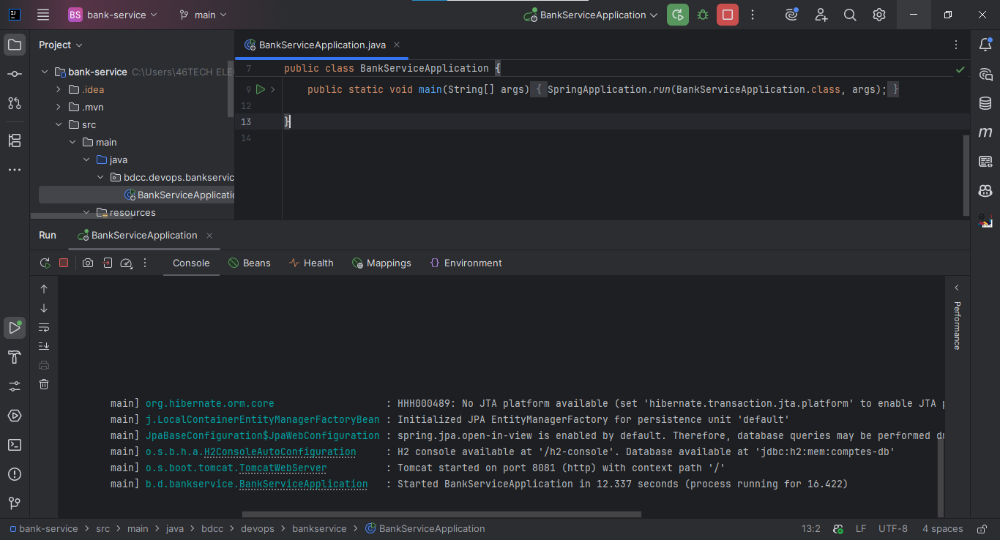

## 2. Entité Compte, 3. CompteRepository, 4. Test DAO
Insertion de 10 comptes au démarrage avec un CommandLineRunner.
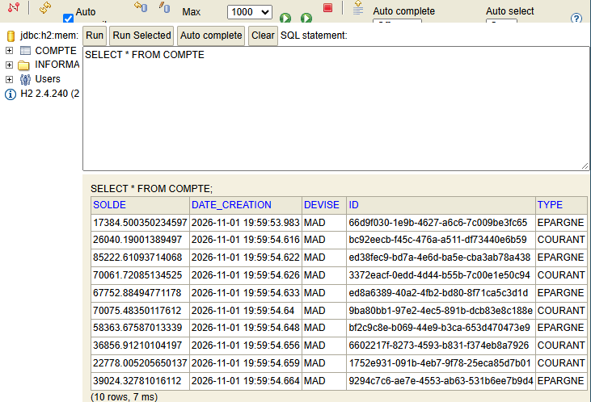


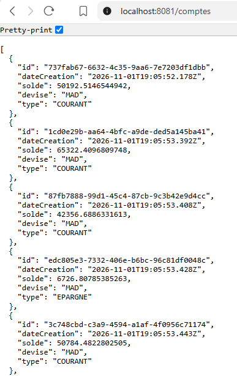

## 5-7. API REST, Swagger
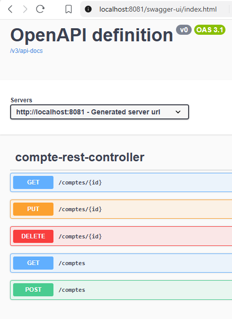

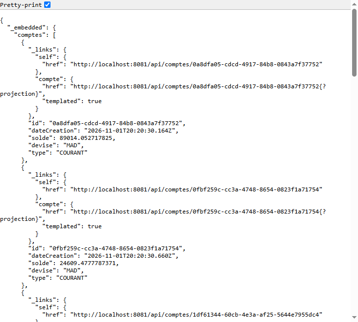

## 8. Projections
### 8.1. CompteProjection1
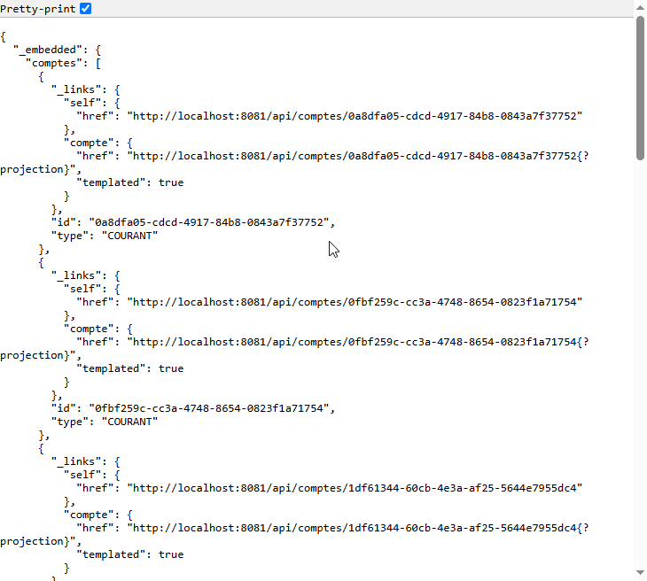
#### 8.2. CompteProjection2
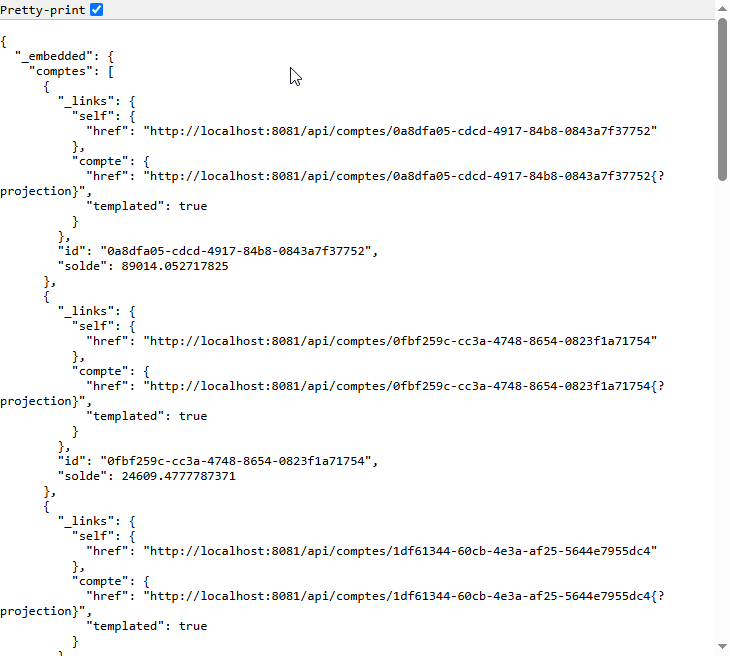

## 9-10. DTO, Mapper et couche service
Le contrôleur appelle CompteService, qui utilise CompteMapper et CompteRepository.
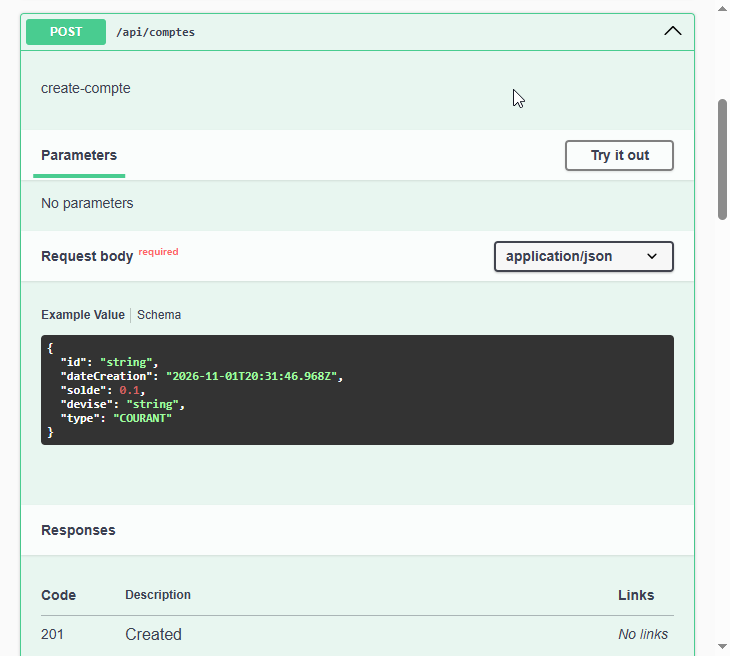
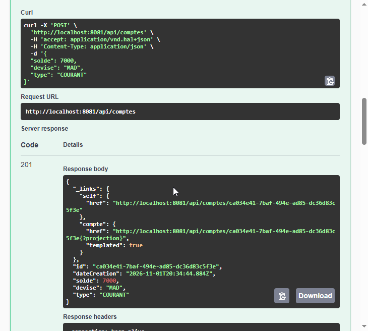

## 10. Web service GraphQL
Ajout de `spring-boot-starter-graphql` et de l'interface GraphiQL (`spring.graphql.graphiql.enabled=true`), accessible sur http://localhost:8081/graphiql.
Le schéma est dans `src/main/resources/graphql/schema.graphqls` et le contrôleur est `CompteGraphqlController`.

Requêtes :

```graphql
query {
  listComptes {
    id
    solde
    type
  }
}
```

```graphql
query {
  compteById(id: "ID_D_UN_COMPTE") {
    id
    solde
    devise
    type
  }
}
```

Avec GraphQL le client choisit les attributs qu'il veut recevoir, c'est comme une projection.

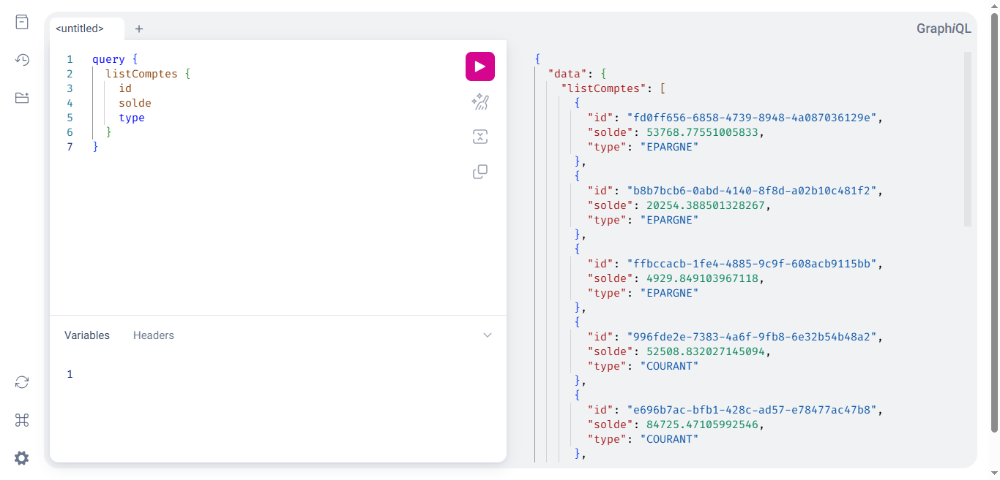

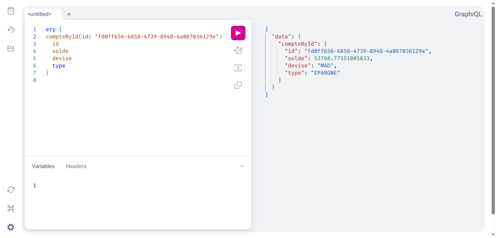

## 11. Gestion des exceptions
Quand un compte n'existe pas, `GraphqlExceptionResolver` retourne un message d'erreur lisible (`Compte ... introuvable`) à la place de l'erreur par défaut.

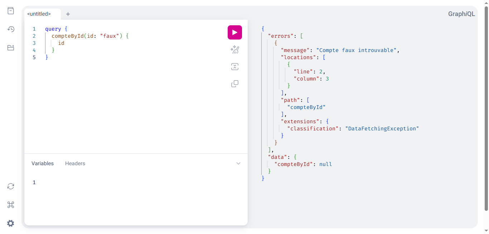

## 12. Mutations
`addCompte`, `updateCompte` et `deleteCompte` passent par la couche service et le DTO `CompteRequestDTO`.

```graphql
mutation {
  addCompte(compte: {solde: 5000, devise: "MAD", type: "COURANT"}) {
    id
    solde
    type
  }
}
```

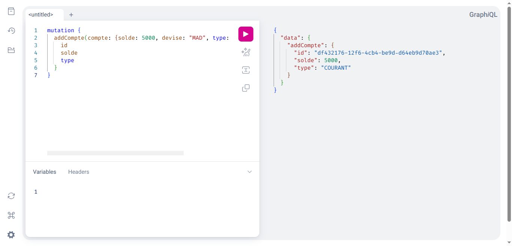

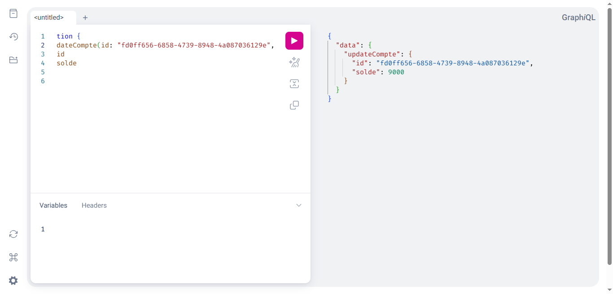

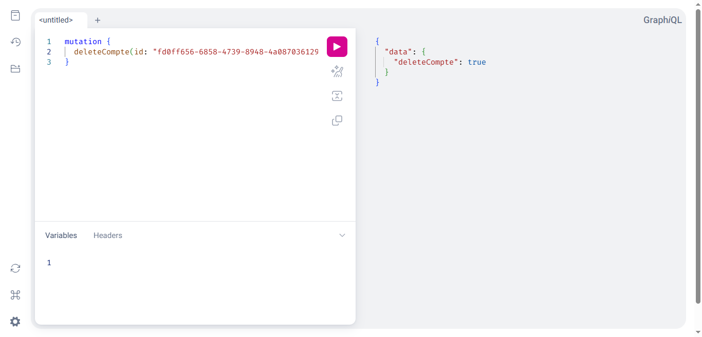

```graphql
mutation {
  updateCompte(id: "ID_D_UN_COMPTE", compte: {solde: 9000}) {
    id
    solde
  }
}
```

```graphql
mutation {
  deleteCompte(id: "ID_D_UN_COMPTE")
}
```

## 13. Entité Client
Un client possède plusieurs comptes (`@OneToMany`) et chaque compte appartient à un client (`@ManyToOne`). Au démarrage, 3 clients sont créés avec 4 comptes chacun.

```graphql
query {
  clients {
    id
    nom
    comptes {
      id
      solde
      type
    }
  }
}
```

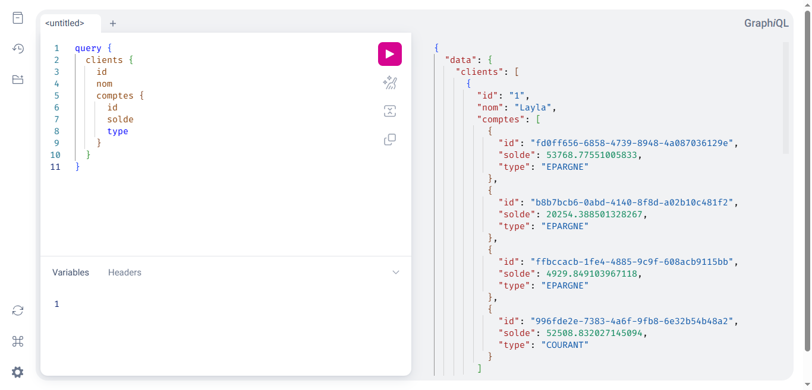

```graphql
query {
  listComptes {
    id
    solde
    client {
      nom
    }
  }
}
```
